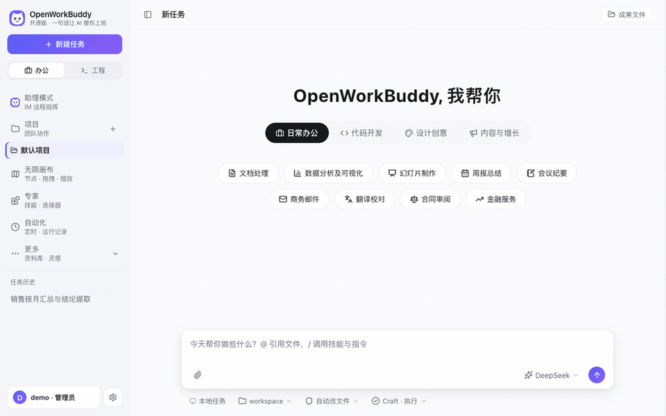
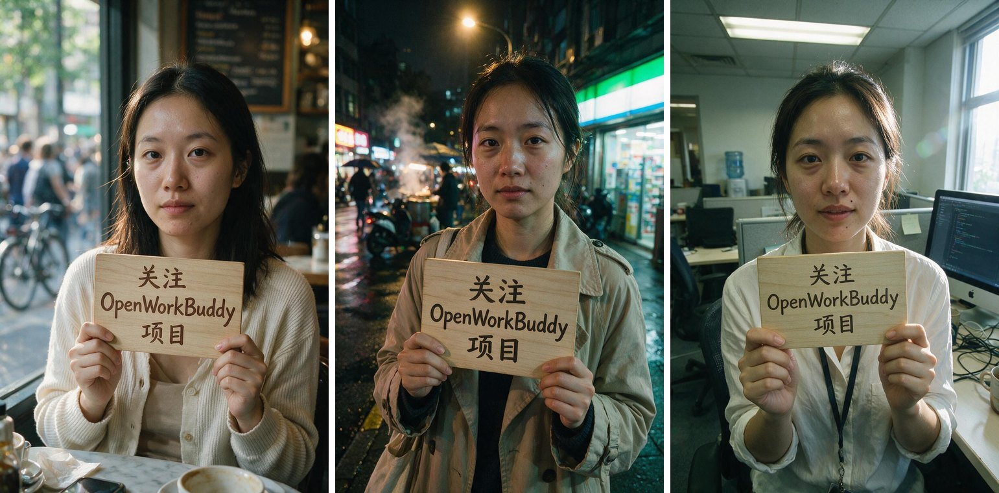
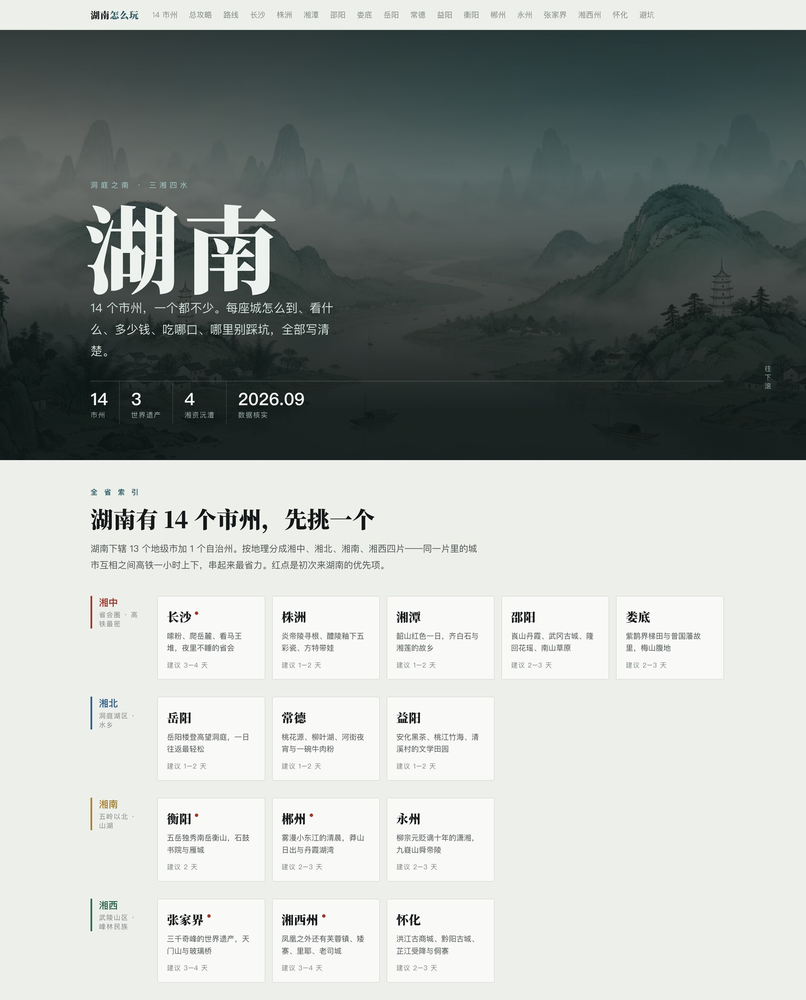
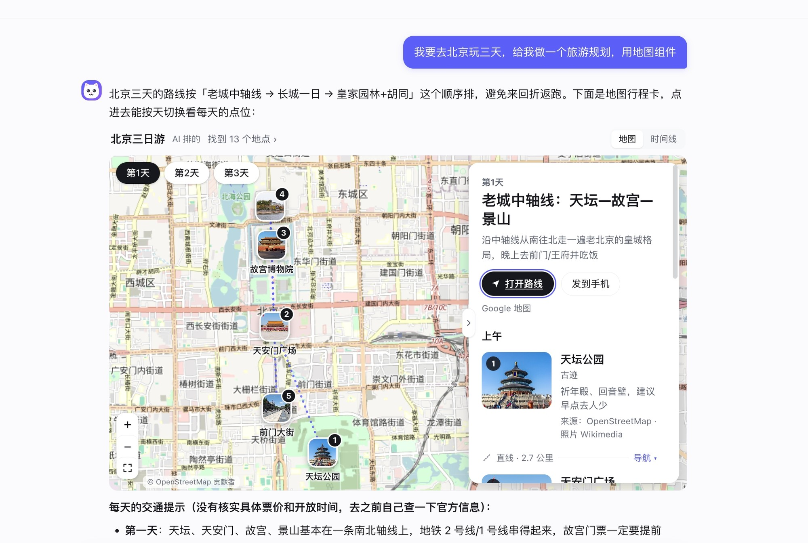
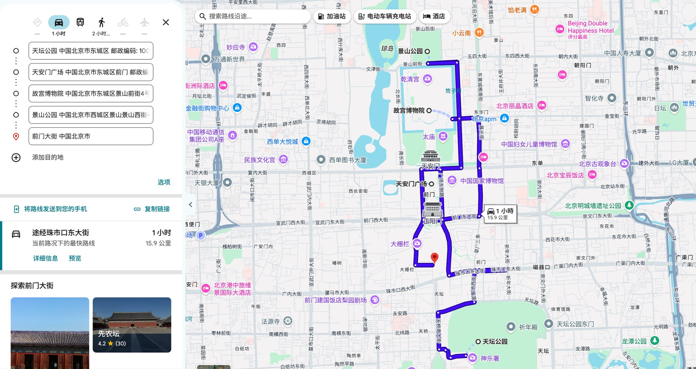
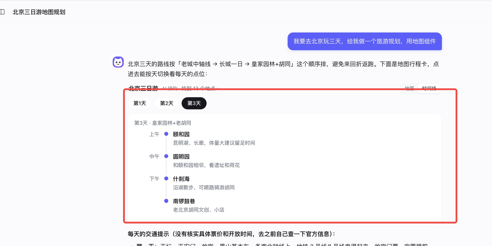
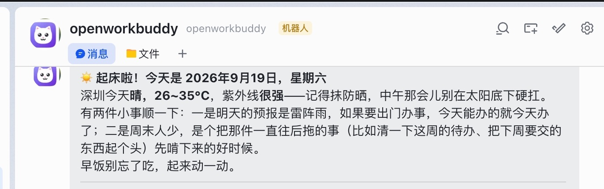

<p align="center"></p>
<h1 align="center">OpenWorkBuddy</h1>
<p align="center"><b>A local-first AI office workbench that turns your material into files you can open and edit.</b><br>
For people who prepare reports, decks, spreadsheets and documents, and teams that need self-hosting.<br>
Choose your model, inspect execution, and review the delivered files.</p>
<p align="center"><a href="#quick-start"><b>▶ Make a project update deck</b></a> · <a href="https://github.com/CatCatUncle/openworkbuddy/releases/latest">Download</a> · <a href="https://catcatuncle.github.io/openworkbuddy/?utm_source=github&amp;utm_medium=readme&amp;utm_campaign=first_result">Project website</a> · <a href="#docs">Docs</a> · <a href="README.md">中文</a></p>
<p align="center"><a href="https://github.com/CatCatUncle/openworkbuddy/releases/latest"></a> <a href="LICENSE"></a> <a href="https://github.com/CatCatUncle/openworkbuddy/stargazers"></a></p>
<p align="center"><sub>Free for personal non-commercial use, schools and non-profits. Company and personal commercial use require a <a href="COMMERCIAL-LICENSE.md">commercial license</a>. To purchase: <a href="mailto:contact@aijentra.com">contact@aijentra.com</a> · WeChat: <b>agi_smith</b>. Model and media services have their own costs.</sub></p>
<p align="center"><br><sub>Workflow demonstration. Measure first success with the task below.</sub></p>

---

<a id="quick-start"></a>
<a id="run-it-in-three-minutes"></a>
## Quick start: make a project update deck

**Prerequisites:** a computer that can run the app and a usable model provider, installed local model, or authenticated local CLI. API use requires your own key. This example uses text and simple shapes; it needs no image/video model, messaging channel, or extra connector. Have PowerPoint, WPS or LibreOffice available to open and check the downloaded deck.

1. **Install and launch.** Choose the macOS / Windows package for your architecture from [Releases](https://github.com/CatCatUncle/openworkbuddy/releases/latest): Windows installer `*-win-setup.exe`, portable `*-win-x64-portable.exe` / `*-win-arm64-portable.exe`, or macOS `.dmg`. On Linux, use source below or [Docker deployment](docs/部署.md).
2. **Connect a model.** Register on first launch. In Settings → Models, enter the provider, exact model ID, API URL and key, then test the connection. An installed local CLI can also be selected under Settings → Agent.
3. **Copy the task and open the result.** Select Craft mode and paste the task below. Preview or download `project-update.pptx` from the results panel, open it in presentation software and check all four slides. Then ask: “Turn the next-week plan on slide 4 into a two-column table. Keep the other slides unchanged.”

```text
Make a 4-slide project update deck saved as project-update.pptx.
Audience: project lead. Project: Example website launch.
Slide 1 | Cover: Example website launch — project update.
Slide 2 | Completed this week: Published the product page; fixed the mobile menu.
Slide 3 | Current progress: Adding the user guide.
Slide 4 | Next week: Finish the English version; collect 5 trial-user feedback responses.
Requirements: 16:9, English, clean business style; editable text,
one main point per slide, readable presentation fonts and no overflowing text.
Keep the supplied facts; do not invent metrics. Confirm the file exists
and provide an openable file in the results panel.
```

**Success means:** a nonempty `project-update.pptx` exists on disk and opens in PowerPoint, WPS or LibreOffice; all four slides match the supplied facts, text is editable and nothing overflows; the follow-up updates slide 4 in the same file. A chat reply or successful installation alone does not satisfy this task. Copyable task files: [English](examples/quick-start/task.en.md) / [中文](examples/quick-start/task.md).

**Timing:** start when installation begins and stop when the first file opens and passes review. Record download, startup, model setup and task wait separately. Three minutes is a design target; actual time depends on network, model readiness and execution. No measured first-success rate has been published yet.

<details>
<summary><b>Run from source: Node.js 18+, npm and Git</b></summary>

```bash
git clone https://github.com/CatCatUncle/openworkbuddy.git
cd openworkbuddy
npm ci
npm start
```

After the server starts, open <http://localhost:3800> and continue with steps 2–3 above. Use `npm run app` for desktop development. Source runs keep data in the repository data directory by default; installed apps use `~/OpenWorkBuddy`. See [Install and launch](docs/安装与启动.md).

</details>

### If you get stuck

| Where it fails | Next step |
|---|---|
| The OS blocks first launch | Follow the OS-specific [launch instructions](docs/安装与启动.md) |
| `npm ci` fails downloading Electron | Check network access and Node version; see [source troubleshooting](docs/安装与启动.md#启动时容易卡住的几件事) |
| The server port is in use | macOS / Linux: `PORT=3801 npm start`; Windows cmd: `set PORT=3801 && npm start`; open the new port |
| Model testing or the task returns an upstream error | Check the API URL, model ID, key and provider quota; see [model setup](docs/配置模型.md) |
| The task waits for an answer or approval | Review the question or approval card above the input, or open the inbox |
| The reply says “done” but the file is missing | Check the active project and results folder; ask it to check `project-update.pptx`. Do not count this attempt as a success |

HTML embedded previews use isolated temporary storage (up to 64 MiB each for `localStorage` and `sessionStorage`, cleared when closed). For a web app that must keep records, choose **Open manually in browser** above the preview. It starts a loopback-only server and opens the current page in your browser, where data survives refreshes under that browser's native storage quota. Keep using the page's own export/backup feature for important data.

Next, try the [core scenarios](#you-say-it-it-hands-you-the-file) or read the [user guide](https://catcatuncle.github.io/openworkbuddy/guides/user.html). Star to bookmark the project; use **Watch → Custom → Releases** for release notifications.

Adjust font size, theme and density from the profile menu → Appearance.

<details open>
<summary><b>Your OS blocks the first launch</b></summary>

The current macOS packages use ad-hoc signing and are not Apple-notarized. Use installers from this repository's Releases.

- **macOS, “could not be verified”**: if you choose to proceed, dismiss the notice, then open **System Settings → Privacy & Security → Open Anyway** and complete the system confirmation. See [Apple's instructions](https://support.apple.com/guide/mac-help/open-a-mac-app-from-an-unknown-developer-mh40616/mac).
- **macOS, “is damaged”**: download again first. If it still fails, check the signature and startup log using the [installation guide](docs/安装与启动.md); this is different from an unknown-developer notice.
- **Windows**: after checking the download source, choose “More info → Run anyway” in SmartScreen.
- **Nothing happens**: inspect `~/OpenWorkBuddy/logs/boot.log` and the [startup troubleshooting guide](docs/安装与启动.md#双击了没反应).

</details>

## You say it, it hands you the file

| You say | You get |
|---|---|
| "Build a Q3 review deck from this spreadsheet" | reads → computes → a `.pptx` you can present |
| "Research AI companion apps in China, write a report" | searches → reads each page → Markdown / Word |
| "Turn this material into a page I can read on my phone" | writes HTML → serves it locally → scan the QR |
| "Every day at 9, collect industry news and send it to me on Feishu" | cron + IM push; missed runs catch up |
| "Make a 30-second product promo, vertical and horizontal" | a form for length, aspect and sound → voice-over, motion, compositing → `.mp4` |

<p align="center">
 
</p>

> [!NOTE]
> Also: parallel tasks, goal-based acceptance, 👍👎 feedback that feeds self-evolution, two-layer memory, permission tiers, remote control over Feishu / WeChat, a desktop pet… Full list (Chinese): **[功能清单](docs/功能清单.md)**.

## Why this one

<table>
<tr>
<td width="50%" valign="top">

<b>📄 The files are real.</b>

Decks, documents, spreadsheets and pages are actually generated — open them from the output panel and check. Review the output panel and the actual file on disk after delivery.

</td>
<td width="50%" valign="top">

<b>🔌 Swap models freely; everything stays yours.</b>

DeepSeek / Qwen / GLM / Kimi / OpenRouter / Ollama switch with one click. Already have <b>Claude Code or Codex</b> on this machine? Use it as the engine — no second token bill. Settings and workspace files remain under your control; cloud models and remote connectors receive the data needed for the task. It listens on <code>127.0.0.1</code> by default.

</td>
</tr>
<tr>
<td width="50%" valign="top">

<b>🧩 Adding a capability = dropping one Markdown file.</b>

Save it as <code>skills/&lt;name&gt;/skill.md</code> and it's live on the next task — no code, no restart, no build.

</td>
<td width="50%" valign="top">

<b>🔍 It's also a readable agent.</b>

Model routing, tool calls, file acceptance, memory, permissions and local traces all live in one repo: for any real task you can see why it did what it did, which model it used, and what it finally handed over.

</td>
</tr>
</table>

<details>
<summary><b>📣 Want to tell someone about it? Copy this</b></summary>

```text
OpenWorkBuddy: an open-source AI office assistant that runs on your own machine.
Ask once; it plans, does the work, checks it, and hands you a PPT / Word / Excel / web page you can open, not a chat log.
· Any model: DeepSeek, Qwen, Kimi, GLM, Ollama, or the Claude Code / Codex already on your machine
· Your data stays local and it listens on 127.0.0.1 by default; or run it on a server for your team, each person binding their own WeChat or Feishu
· Adding a capability = dropping in one Markdown file
Good for: people who live in decks, weekly reports and research docs; teams that want a self-hosted AI assistant; developers who want to see how an agent is built.
Free for personal non-commercial use: https://github.com/CatCatUncle/openworkbuddy
```

</details>

## What it looks like

**"Same person, four different scenes, holding a hand-written sign — make it look like a snapshot, not an AI render."**

<p align="center">
 
</p>

The hard part isn't drawing a person — it's keeping the same person across all four and the Chinese on the sign legible. So it generates one, then actually looks at what it just made (a real vision call on its own output, not a claim from memory), and fans the rest out from there.

**"Build me a Hunan travel guide site — all 14 prefectures, no skipping."**

<p align="center">
 <a href="https://hunan-travel.pages.dev/"></a>
</p>

**<https://hunan-travel.pages.dev/>** — it's live, go click around. One HTML file plus a folder of images, no external CDN. Drop it on any static host and it's a site. Not a mockup — the thing it actually handed over.

**"I'm spending three days in Beijing — plan the trip for me, and use the map card."**

<p align="center">
 
</p>

<p align="center">
 
</p>

<p align="center">
 
</p>

The itinerary in the answer becomes a trip card: switch between days, every stop is pinned on the map in order, and the place cards on the right come with photos. "Open route" carries the day's stops into the map in order, under the same names as on the card; in China it opens AMap by default with a switch to Google (that's the second shot), abroad it opens Google Maps; "Send to phone" shows a QR code to carry on from your phone. Flip to "Timeline" at the top right and the day runs from morning to evening. Works without a Key; add an AMap Key in Settings → Map and places in China get more accurate.

**"Every morning at seven, send me today's weather and what I should watch out for, on Feishu."**

<p align="center">
 
</p>

Scheduled tasks run while the application is running. Automation → Run history shows execution and notification delivery separately. Feishu notifications require bot credentials and an explicit recipient ID in Assistant settings; see [IM and scheduled tasks](docs/IM与定时任务.md).

How it pulled those off → **[三个案例，拆开讲](docs/案例.md)** (Chinese, but the screenshots speak for themselves)

## Creative infinite canvas

Start with an image, video or set of assets. Describe, connect references, generate and continue with variations or video directly from each card. Short-drama workflows also organize scripts, characters, scenes, shots, voice and the edit timeline. Connections become real generation inputs.

Edit character and location descriptions and choose an image model directly on their cards. Unspecified models follow the current app’s default; Agent writes with unregistered model IDs are rejected. Invalid model IDs are caught before submission; choosing the default overrides an inherited script model. [Usage and troubleshooting](docs/无限画布使用.md#角色定妆照与场景图).

Ark portrait errors stay on the card. Use approved asset IDs for reference generation; video frame uploads preserve original bytes. [Portrait assets and generation modes](docs/无限画布使用.md#火山视频提示输入图片可能包含真人).

<p align="center">
 
</p>

<details>
<summary>Example: a 75-second AI short-drama episode</summary>

**A whole AI short-drama episode from one sentence**: ask for "an episode of 《不烧心》 as a vertical short drama" and it goes script → character sheets → storyboard → first frames → shot videos → final cut. This 75-second episode was made that way (click the cover to watch).

<p align="center">
 <a href="docs/videos/ai-short-drama-ep01.mp4"></a>
</p>

</details>

Open "Infinite canvas" in the left sidebar. Drag empty space to pan, `Shift`+drag to marquee-select, `Shift`/`⌘`+click to add or drop nodes from the selection, and expand Agent to reference nodes or assets with `@`.

Edit models, references and prompts on cards, compare versions and open Agent when needed. Empty prompts never start generation. Growing cards move their neighbors once; compact result cards retain visible failure details. Duplicate with references, arrange selections, navigate with the optional minimap and export the canvas together with its assets. See the [canvas guide](docs/无限画布使用.md) (Chinese).

## Put it on a server for your team: multi-user, self-hosted

```bash
git clone https://github.com/CatCatUncle/openworkbuddy.git && cd openworkbuddy
bash deploy.sh --domain buddy.example.com # Docker + automatic HTTPS
```

Multi-tenant, with seats, quotas and one-click offboarding. **Register the admin first** — the first account becomes super admin.
→ [部署](docs/部署.md) · [ops handbook](deploy/README.md) · [多人协作](docs/多人协作.md) · [账号与部署运维](docs/账号与部署运维.md) (Chinese)

## Models: DeepSeek, Qwen, Kimi, Ollama, Claude Code, Codex

**Settings → Models**: pick a preset (OpenAI / Anthropic / OpenRouter / DeepSeek / Qwen / Zhipu / Kimi / Volcengine Ark / Ollama), paste the key, save — it applies immediately. Image, voice and video models have their own table. Reference → [配置模型](docs/配置模型.md) (Chinese)

Assistant mode can also select local Codex, Claude Code, or a configured API model. It follows your current engine by default; changing its selection does not change scheduled task settings.

> [!IMPORTANT]
> Keys live only in `config.json`, which is already in `.gitignore`. Don't commit it.

## Command line

`openworkbuddy` shares **one** set of config, skills, memory, connectors and sessions with the desktop app — start something in the terminal and you can watch it and chime in from your phone; stop halfway on the desktop and `openworkbuddy resume` picks it up.

The default display keeps one progress line, the final answer and files actually changed in the current turn. Use `/details` for tool output, `/usage` for token usage, and `/verbose on` for detailed activity. Say “open it” after creating a page to open the session's result with a local application, or use `/open 1` and `/open subdirectory/index.html`.

```bash
npm link # once: install the global command (or just run `node cli.js …`)

openworkbuddy "write my weekly report" # one-shot: runs and exits
openworkbuddy # interactive: type / for the command menu
cat error.log | openworkbuddy "what is this" # pipe: stdin becomes material
openworkbuddy -q "write my weekly report" > report.md # just the report, no progress bars
```

One-shot and pipe mode **never** ask you questions, so scripts and cron don't hang. Exit codes mean something: `0` success, `1` task failed, `2` bad arguments, `130` Ctrl+C — so `openworkbuddy doctor && npm start` stops a misconfigured machine before it starts.

`sessions` / `resume` / `engines` / `doctor` / `pair` (QR-pair your phone) / `worktree`, plus `--mode` `--perm` `-C` `-f` `--json` and the rest → **[命令行用法](docs/命令行用法.md)** (Chinese)

## How it's put together

<p align="center">
 
</p>

Entry points are `server.js`, `cli.js` and `src/im/`; the Agent is in `src/agent/agent.js`, with tools in `src/agent/tools.js` and `src/tools/`. Sessions, config and usage are stored locally under `data/`; task files go to the project workspace. See [code architecture](docs/代码架构.md) for layers and [implementation details](docs/实现细节.md) for a task walkthrough (both Chinese).

## What's new

- **Oct 27** Project and automation search preserve the input and caret, wait for IME confirmation, and reuse loaded lists. Ignore late run-history responses after switching views.

- **Oct 26** Execution traces persist across projects and show local-engine tool results and read errors. The sidebar shows Experts · Skills · Connectors.
- **Oct 26** Library search preserves the input and caret, waits for IME confirmation, and ignores stale responses to prevent reordered text.

- **Oct 24** Keep task navigation in one desktop workbench. Remove the session menu’s new-window action, reuse the main window for task links and preview redirects, and retain separate file previews.

- **Oct 23** Remove three dependency cycles; share workspace context across tools and connectors, and avoid loading the tool executor just to locate connector files

- **Oct 23** Edit text models directly; disconnect the local Feishu user identity; prevent scheduled Feishu results from being sent again through another bot after a delivery receipt

- **Oct 23** Keep canvas models scoped to the current app; restore defaults on cards and prevent API or local engines from guessing model IDs from another installation

- **Oct 23** Select models on cards; fix missing-tool claims by local engines. Keep shot outputs and errors inline, show start feedback, support approved Ark assets, preserve original frames, compare versions and export assets
- **Oct 21** Keep read notifications, find scheduled results in the inbox, and jump to conversation search matches from a visible search button
- **Oct 20** File links retain their project and full local path; previews and deployments no longer switch to same-name files or accept stale responses
- **Oct 20** Installed apps register a bundled-runtime CLI; Windows checks cover Unicode/space paths and the launch directory. Rerun `npm link` after moving a source checkout
- **Oct 20** Two groups of five common tasks; pin directly from task rows and rename from the menu; local session imports and read-only sharing are disabled
<details>
<summary>More updates</summary>

- **Oct 20** Read notifications stay read; run summaries distinguish ended, stopped and incomplete turns; inline script checks and video output collision protection
- **Oct 20** Source updates check Git state first; keep modified or divergent checkouts intact to protect sessions and deliverables
- **Oct 19** Rework the architecture diagram to match actual calls and use scalable SVG so node labels stay readable
- **Oct 19** Rename tasks and identify dated previews; Goal checks unmet work and resumes in bounded rounds after 100 steps; CLI sandbox denials explain approval limits
- **Oct 19** Embedded preview temporary storage now allows 64 MiB per `localStorage` and `sessionStorage` store and clears on close.

- **Oct 19** HTML previews now fill the side panel and keep a real viewport for interactive pages; switch to fit-to-page when you want to see a full static page

- **Oct 17** Compact CLI output with on-demand diagnostics and usage; fix blank interjections, stale file lists and lost follow-ups, and open session results directly with local applications

- **Oct 16** Games and buttons work in HTML previews with isolated temporary storage; application data remains separate
- **Oct 16** HTTP connector OAuth adds provider authorization, token refresh and local credential removal
- **Oct 16** Preview region annotations and line comments enter editable revision drafts; individual change blocks can be reverted and restored
- **Oct 16** Team tasks use organization models and connectors with separate usage records; browser recordings generate reviewable skill drafts
- **Oct 16** English UI tests catch untranslated text while preserving user content; the website includes bilingual user and developer guides

- **Oct 16** Owners can create and revoke organization-only read-only task links; sharing settings stay in the page and are hidden in single-user mode
- **Oct 16** Quick start now leads to an editable project update deck, with a copyable task, review criteria, troubleshooting and explicit gaps in adoption metrics
- **Oct 15** Execution plans stay in the conversation as collapsible lists. Updates preserve expansion and keyboard focus, and the list scrolls with your messages
- **Oct 15** Pin tasks to a Pinned group at the top of the history; pins follow you to other computers
- **Oct 15** Accept in Self-evolve no longer reloads the page; Self-evolve and Agents open without a multi-second wait
- **Oct 14** Every account can bind its own WeChat, Feishu, QQ, WeCom, Official Account, group bots and email: messages run as you, results go only to you
- **Oct 14** Members on a shared server get their own setup: per-provider model sharing, their own API keys, their own experts, and their own assistant name and preferences
- **Oct 14** Attachments with the Chinese enumeration comma (、) in their names are no longer split into two files that don't exist
- **Oct 13** Sign up with an email: the part before @ becomes your username, and signing in with the email works too; failed sign-ups no longer count toward the limit
- **Oct 13** New "Sandbox safety" switch in Settings → Security: turn it off and the AI can touch files outside the workspace and reach local and private addresses; locked on when several accounts share one install
- **Oct 13** "Allowed local/private addresses" accepts wildcards: 192.168.1.*:* for a whole subnet, *.local:8080 for a family of hosts
- **Oct 12** Your personal WeChat now gets scheduled-task results and reminders; messages keep arriving while a task runs, so "stop" works right away, and WeChat shows "typing…" while it works
- **Oct 12** Local Codex / Claude Code can read files sent with a message: pasted text, images and documents now come with their full path, not just the file name
- **Oct 10** Members, auditors and branch-org accounts can create multiple projects too: each gets its own folder inside their own working folder, and earlier outputs stay in the default project
- **Oct 10** Drag from a canvas card's port onto another card to link them; cards that can't take the link turn red and say why. "+" adds a card that's already linked, and titles and prompts can be edited right on the card

</details>

Full history → **[Changelog](CHANGELOG.en.md)**.

## ⚠️ This agent has a shell

It runs commands, edits files and goes online, so there are command approvals, file blocklists, a URL allowlist, an audit log and four permission levels; on macOS and Windows its commands also run in a system sandbox that can't read your Keys or ledger. Third-party skills get a static check before install and risky ones are refused by default — but it isn't antivirus; read the `skill.md` yourself.
**Read [安全](docs/安全.md) before exposing it to the internet** — defaults are tuned for local use.

## Contributing

- **Something broke? [Open an issue](https://github.com/CatCatUncle/openworkbuddy/issues/new)**, even if it's one line of error text. Scrub your API keys first.
- **10 minutes** — write a skill: one Markdown file at `skills/<name>/skill.md`, live on save. [Template](CONTRIBUTING.md#提交一个技能3-分钟)
- **One evening** — pick an issue: `npm install && npm start` runs it, `npm test` goes green without any API key

Project layout, tests and PR conventions are in [CONTRIBUTING.md](CONTRIBUTING.md). No need to open an issue first — send the PR.

## Coming from another tool: open-source alternative to Claude Cowork, Codex and more

Looking for an **open-source alternative to Claude Cowork, Codex, Doubao or Qwen office features**, or a **DeepSeek agent harness**? Each has an honest comparison page, including when the other product is the better fit:

| You use / you're looking for | Comparison |
|---|---|
| Claude Cowork | [Open-source Claude Cowork alternative — self-hosted, any model](https://catcatuncle.github.io/openworkbuddy/alternatives/claude-cowork/) |
| Codex | [Codex alternative for office work — and it can drive the Codex CLI](https://catcatuncle.github.io/openworkbuddy/alternatives/codex/) |
| Doubao | [Doubao office alternative — still runs Doubao models](https://catcatuncle.github.io/openworkbuddy/alternatives/doubao/) |
| Qwen | [Qwen office alternative — runs Qwen via DashScope or Ollama](https://catcatuncle.github.io/openworkbuddy/alternatives/qwen/) |
| DeepSeek | [DeepSeek agent harness — paste a key and it works](https://catcatuncle.github.io/openworkbuddy/alternatives/deepseek-agent/) |

OpenWorkBuddy is an independent open-source project, not affiliated with any of these companies.

## Docs

First-success testing, timing definitions and missing metrics → [Adoption and feedback](docs/采用与反馈.md#english).

Most docs are in Chinese; the code and comments are the source of truth.

Online guides: **[User guide](https://catcatuncle.github.io/openworkbuddy/guides/user.html)** · **[Developer guide](https://catcatuncle.github.io/openworkbuddy/guides/developer.html)** · [Bilingual project website](https://catcatuncle.github.io/openworkbuddy/)

| Doc | What's in it | Doc | What's in it |
|---|---|---|---|
| [功能清单](docs/功能清单.md) | Every capability, skill and tool | [部署](docs/部署.md) | Server / Docker / reverse proxy |
| [案例](docs/案例.md) | How the pictures above were made | [多人协作](docs/多人协作.md) | Multi-tenant, accounts, quotas |
| [安装与启动](docs/安装与启动.md) | Installers, source, common snags | [安全](docs/安全.md) | Approval gates, allowlists, audit |
| [配置模型](docs/配置模型.md) | base_url / model names per provider | [数据同步与搬家](docs/数据同步与搬家.md) | Where data lives, moving machines |
| [命令行用法](docs/命令行用法.md) | CLI flags, pipes, `--json`, cron | [开源与商业版边界](docs/开源与商业版边界.md) | What a licence actually buys |
| [扩展](docs/扩展.md) | Skills, MCP, plugins, experts | [路线图](docs/路线图.md) | What's next, what counts as done |
| [IM与定时任务](docs/IM与定时任务.md) | Feishu / QQ / WeCom / WeChat / DingTalk | [实现细节](docs/实现细节.md) | How the agent loop actually runs |
| [安全基线](docs/安全基线.md) | Where data lands, who can read it, what isn't covered | [远程访问](docs/远程访问.md) | Reaching your machine from outside; both switches off by default |
| [账号与部署运维](docs/账号与部署运维.md) | Accounts, offboarding, password recovery, backups, running several orgs | [代码架构](docs/代码架构.md) | How the code is layered, who may require whom, where new code goes |

## Also by the same author

- **[toolward](https://github.com/CatCatUncle/toolward)** — a static safety check for agent skills and MCP connectors: 37 rules in six families, zero runtime dependencies, Node 20.10+. Run `npm i -g toolward` and OpenWorkBuddy picks it up as a second ruler automatically; skip it and nothing changes. Like this project it is PolyForm Noncommercial.

## Commercial license · Enterprise services

> [!IMPORTANT]
> **Free for personal non-commercial use, schools and non-profits. Company use (even internal only) and personal commercial use require a paid commercial license.**
> Companies may evaluate it free for up to 30 days, as long as it isn't used in real business yet; long-term use requires a license.
> **To purchase a commercial license, email [contact@aijentra.com](mailto:contact@aijentra.com) or add WeChat `agi_smith`.** Include your company, use case and expected user count; mention “OpenWorkBuddy commercial license” in your WeChat request. Terms: [COMMERCIAL-LICENSE.md](COMMERCIAL-LICENSE.md).

| Your situation | License needed? |
|---|---|
| Personal non-commercial use (learning, research, hobby projects) | Free |
| Schools, research institutions, non-profits, government bodies | Free |
| Company evaluation: up to 30 days, not yet used in real business | Free |
| A company or team using it in real business, **even internal only** | **Required** |
| **Personal commercial use**: freelancing, client work, paid products or services | **Required** |
| SaaS offered to others, bundling into products you sell, client delivery / outsourcing / custom work | **Required** |

A license unlocks no features: there is only this one codebase, with no feature locks, no countdowns and no online license checks. The software sends no usage data to the author or any third party; when it checks for updates, it asks GitHub Releases whether a new version is out (GitHub can see your IP).
Commercial use without a license can be pursued by the rights holder under civil law, and removing or altering copyright notices without permission may itself infringe — legal basis and court cases in [未授权商用的法律后果](COMMERCIAL-LICENSE.md#未授权商用的法律后果) (Chinese).

Beyond licensing, we take on enterprise AI work:

| Service | What it covers |
|---|---|
| **Enterprise FDE (forward-deployed engineering)** | Engineers join your team, wire Agents into real business workflows, and hand over once it runs |
| **AI training** | In-house training so your team uses AI in everyday work, not just demos |
| **AI adoption consulting** | Pick the use cases, shape the plan, size the cost; private deployment and industry agents included |

The author is a former big-tech Agent engineer who has delivered AI solutions for cross-border e-commerce, manufacturing, AI startups, private funds, major consumer brands and state-owned enterprises. Based in Shenzhen — visits welcome.

📮 Licensing and business inquiries: **[contact@aijentra.com](mailto:contact@aijentra.com)** · WeChat: **`agi_smith`**

## License

**Free for personal non-commercial use, schools and non-profits; company use (even internal only) and personal commercial use need a commercial license.** Companies may evaluate free for 30 days. To purchase a commercial license, email **[contact@aijentra.com](mailto:contact@aijentra.com)** or add WeChat **`agi_smith`** (mention “OpenWorkBuddy commercial license”).

[PolyForm Noncommercial 1.0.0](LICENSE); terms and what unlicensed commercial use leads to are in [COMMERCIAL-LICENSE.md](COMMERCIAL-LICENSE.md). Deploy configs, scripts and skill templates are also MIT ([the list](COMMERCIAL-LICENSE.md#按-mit-授权的部分)); the name and logo aren't licensed.

Anyone who copies or redistributes any part of this software must keep the license terms (or their URL) and every line beginning with `Required Notice:` at the top of [LICENSE](LICENSE).

Official releases are published only at CatCatUncle/openworkbuddy on GitHub and its Releases. Installers from other sources get no updates or support from the author; users' rights are those under the PolyForm Noncommercial License 1.0.0 and any commercial license.

**KylinWork and others built on this project's code without the author's permission and changed its license; the author has demanded they be taken down everywhere.**

Copyright (c) 2026 开发者猫叔 (DeveloperCatUncle)

## Disclaimer

An independent open-source project, not affiliated with Tencent or its WorkBuddy product, containing none of its code or assets; IM integrations use public APIs only. Borrowed ideas are credited in [NOTICE.md](NOTICE.md). Concerns → [Issues](https://github.com/CatCatUncle/openworkbuddy/issues).

## Support this project

<p align="center">
 <a href="https://github.com/CatCatUncle/openworkbuddy">
 
 </a>
</p>

<p align="center">
 <a href="https://github.com/CatCatUncle/openworkbuddy"></a>
</p>

<p align="center">
 <sub>Pass it to one colleague who hand-builds decks, weekly reports and meeting notes — worth more than a hundred impressions.</sub>
</p>

## Contributors

Thanks to everyone who has changed something here. Want to join them: [CONTRIBUTING.md](CONTRIBUTING.md).

<p align="center">
<a href="https://github.com/CatCatUncle/openworkbuddy/graphs/contributors">
 
</a>
</p>

## Star history

<p align="center">
<a href="https://star-history.com/#CatCatUncle/openworkbuddy&Date">
 <picture>
 <source media="(prefers-color-scheme: dark)" srcset="https://api.star-history.com/svg?repos=CatCatUncle/openworkbuddy&type=Date&theme=dark">
 
 </picture>
</a>
</p>
